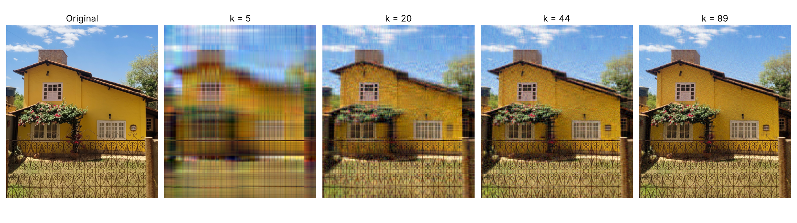
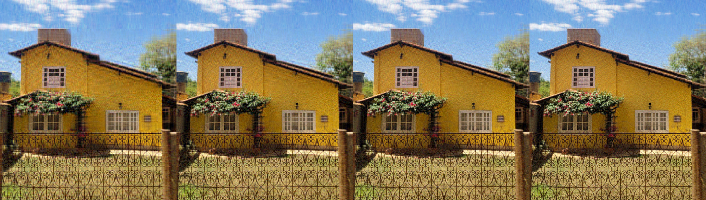
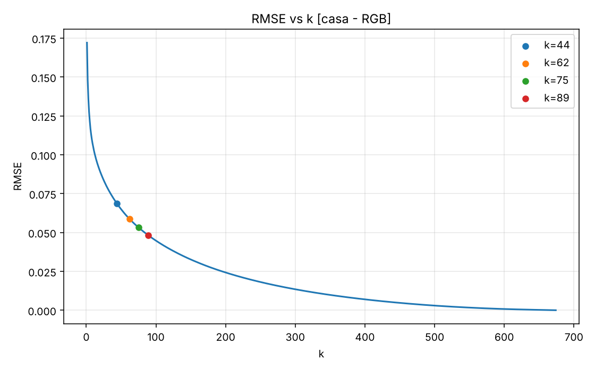
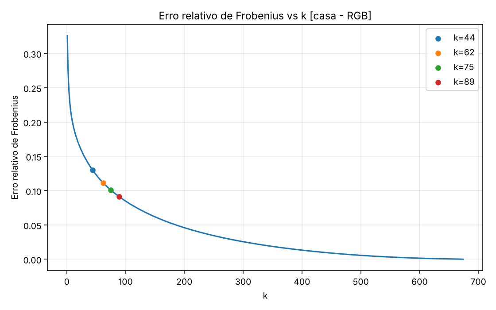
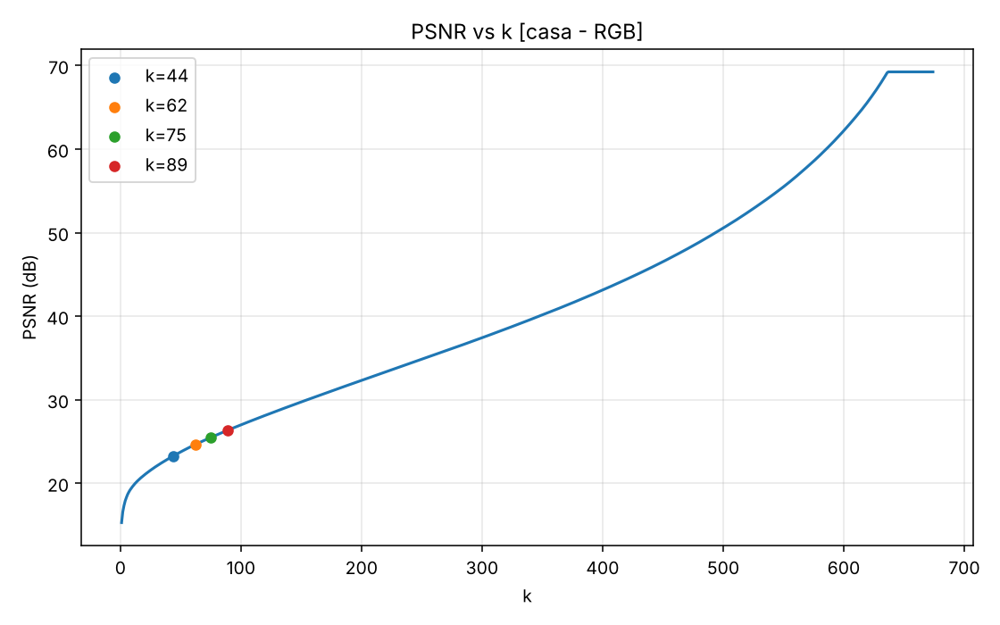
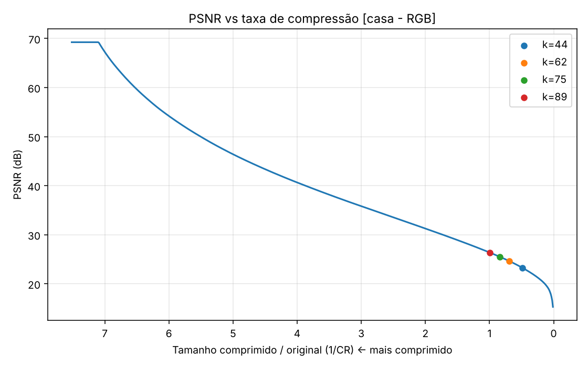

# Compressão de Imagens via Decomposição em Valores Singulares (SVD)

Projeto de Iniciação Científica, financiado pela CNPq, que estuda a aplicação da Decomposição em Valores Singulares (SVD) na compressão de imagens.

O código decompõe a imagem, gera aproximações de posto reduzido, calcula métricas de qualidade e de compressão e produz os resultados para diferentes valores de *k*, permitindo analisar a relação entre **redução de armazenamento** e **preservação da informação**. O relatório final apresenta a metodologia, os resultados experimentais e as principais observações do estudo.

---

## Como funciona

Uma imagem (ou cada canal dela) é tratada como uma matriz $A \in \mathbb{R}^{m \times n}$. A SVD fatora essa matriz como:

$$A = U \Sigma V^T$$

Mantendo apenas os $k$ maiores valores singulares, obtém-se a melhor aproximação de posto $k$ (Eckart–Young):

$$A_k = U_k \Sigma_k V_k^T = \sum_{i=1}^{k} \sigma_i \, u_i v_i^T$$

Em vez de armazenar $m \times n$ valores, guardam-se apenas $U_k$, $\Sigma_k$ e $V_k$. Quanto menor o *k*, maior a compressão e maior a perda de qualidade.

**Tratamento por tipo de imagem**

- **PB (tons de cinza):** uma SVD sobre a matriz da imagem (8 bits por pixel).
- **RGB:** uma SVD independente para cada canal (R, G e B), com 24 bits por pixel.
- Imagens RGB cujos canais são praticamente idênticos (tolerância de 1/255) são detectadas e processadas como PB.

---

## Estrutura do repositório

| Arquivo | Descrição |
|---|---|
| `main.jl` | Ponto de entrada. Carrega as imagens passadas na linha de comando, calcula a SVD e dispara o processamento. |
| `svd_funcoes.jl` | Módulo `SVD_funcoes` com toda a lógica: extração de canais, reconstrução de posto *k*, métricas, cálculo de tamanho, geração de CSV, mosaico e gráficos. |
| `grafico.py` | Script em Python que gera gráficos de cada métrica em função de *k* a partir de um CSV de métricas. |
| `metricas(PB).csv` / `metricas(RGB).csv` | Métricas obtidas para uma imagem em tons de cinza e uma colorida. |
| `pb.png` / `rgb.png` | Imagens de exemplo (tons de cinza e colorida). |
| `exemplos/casa/` | Exemplo de aplicação em uma foto colorida: imagem original, `metricas.csv`, `mosaico.png`, reconstruções e gráficos. |
| `Relatório_Final.pdf` | Relatório final da Iniciação Científica. |
| `Sinopse.txt` | Resumo do projeto (PT/EN). |

---

## Requisitos

### Julia

Pacotes utilizados:

`FileIO`, `Images`, `ImageCore`, `Plots`, além das bibliotecas padrão `LinearAlgebra`, `Statistics`, `Printf` e `Serialization`.

Instalação dos pacotes externos:

```julia
using Pkg
Pkg.add(["FileIO", "Images", "ImageCore", "Plots"])
```

> Dependendo do formato das imagens, pode ser necessário um backend de leitura/escrita, por exemplo `Pkg.add("ImageIO")`.

### Python (somente para `grafico.py`)

```bash
pip install pandas matplotlib
```

---

## Uso

### 1. Rodar a SVD e gerar os resultados

```bash
julia main.jl imagem.formato
```

É possível processar várias imagens de uma vez:

```bash
julia main.jl pb.png rgb.png
```

Se nenhum argumento for passado, o programa exibe a mensagem de uso e encerra.

### 2. Saídas geradas

Para cada imagem, é criada a pasta `resultados_svd/<nome_da_imagem>/` com:

```
resultados_svd/<nome_da_imagem>/
├── metricas.csv          # métricas para cada valor de k
├── mosaico.png           # reconstruções para alguns valores de k, lado a lado
├── reconstrucoes/
│   └── k<N>.png          # imagem reconstruída com posto k = N
└── graficos/
    ├── rmse_vs_k.png
    ├── frob_rel_vs_k.png
    ├── psnr_vs_k.png
    └── psnr_vs_cr.png
```

Se já existir um `metricas.csv` (e/ou reconstruções) de uma execução anterior, os valores de *k* já processados são reaproveitados, evitando recálculo.

### 3. Gráficos adicionais com `grafico.py`

O script lê um arquivo chamado `metricas.csv` (separador `;`) no diretório atual e gera um gráfico por métrica numérica na pasta `graficos/`, destacando alguns valores de *k*.

```bash
cp "resultados_svd/<nome_da_imagem>/metricas.csv" .
python grafico.py
```

Os valores de *k* destacados (`PONTOS_K`), o ponto extra do PSNR (`PONTO_PSNR_EXTRA`), o caminho do CSV (`CSV_PATH`) e a pasta de saída (`SAIDA_DIR`) podem ser ajustados no início do arquivo.

---

## Métricas calculadas

Para cada $k$ de 1 até o número máximo de valores singulares, o `metricas.csv` registra:

| Coluna | Significado |
|---|---|
| `k` | Posto da aproximação |
| `Tipo` | `PB` ou `RGB` |
| `MSE` | Erro quadrático médio entre a imagem original e a reconstruída |
| `RMSE` | Raiz do erro quadrático médio |
| `PSNR_dB` | Relação sinal-ruído de pico, em dB |
| `FrobAbs` | Norma de Frobenius do erro, $\lVert A - A_k \rVert_F$ |
| `FrobRel` | Erro relativo de Frobenius, $\lVert A - A_k \rVert_F / \lVert A \rVert_F$ |
| `RawBytes` | Tamanho bruto da imagem original (sem compressão) |
| `SVDRealBytes` | Tamanho real dos fatores $U_k$, $\Sigma_k$, $V_k$ truncados, medido por serialização |
| `CompressionRatio` | Relação entre o tamanho comprimido e o original (`SVDRealBytes / RawBytes`, ou seja, $1/CR$) |

> Na saída do programa e nos gráficos, a **taxa de compressão** é $CR = \text{RawBytes} / \text{SVDRealBytes}$. A coluna `CompressionRatio` do CSV guarda o inverso ($1/CR$).

### Valores de *k* de referência

O programa também determina:

- **k máximo útil:** maior *k* para o qual a compressão ainda é real ($CR > 1$), encontrado por busca binária.
- **k de equivalência:** ponto em que $CR \approx 1$ (obtido por interpolação linear entre dois valores inteiros de *k*).

---

## Observações

- Os valores de pixel são normalizados para o intervalo $[0, 1]$ (`Float32`) e as reconstruções são limitadas (*clamp*) a esse intervalo.
- O tamanho da representação SVD é medido de forma **real** (serializando os fatores truncados), e não por uma fórmula teórica.
- O mosaico usa valores de *k* fixos por posição (`ks[44]`, `ks[62]`, `ks[75]`) mais o *k* máximo útil; essa escolha está em `svd_funcoes.jl` e exige que a imagem tenha pelo menos 75 valores singulares.

---

## Exemplo de aplicação

Como exemplo, a SVD foi aplicada a uma fotografia colorida (RGB) de uma casa, de **768 × 674 pixels**. A imagem tem grades de ferro forjado, folhagem e céu com nuvens, ou seja, regiões lisas misturadas com muito detalhe fino, o que a torna um bom teste.

Os arquivos completos estão em [`exemplos/casa/`](exemplos/casa/).

> **Nota:** estes resultados foram gerados com um *port* em Python (numpy) do mesmo algoritmo de `main.jl` / `svd_funcoes.jl`: SVD por canal, mesmas métricas e mesmo critério de *k* útil. Ao rodar `julia main.jl casa.png`, diferenças pequenas são esperadas, principalmente em `SVDRealBytes`, porque o Julia mede o tamanho serializado e inclui o *overhead* da serialização. Aqui o tamanho é o de 3 × ($U_k$, $\sigma_k$, $V_k$) em `Float32`.

### Original e reconstruções



O mosaico que o próprio programa gera (`mosaico.png`) mostra, lado a lado, as reconstruções com $k = 44, 62, 75$ e $89$:



### Métricas

Imagem original: **1.552.896 bytes** (768 × 674 × 3). Tempo de SVD dos três canais: cerca de 0,7 s.

| k | PSNR (dB) | RMSE | Erro rel. Frobenius | Tamanho da SVD (bytes) | CR |
|---:|---:|---:|---:|---:|---:|
| 1 | 15,29 | 0,1721 | 32,59 % | 17.316 | 89,68 |
| 5 | 18,30 | 0,1217 | 23,04 % | 86.580 | 17,94 |
| 10 | 19,59 | 0,1049 | 19,86 % | 173.160 | 8,97 |
| 20 | 21,01 | 0,0890 | 16,87 % | 346.320 | 4,48 |
| 44 | 23,27 | 0,0686 | 12,99 % | 761.904 | 2,04 |
| 62 | 24,62 | 0,0587 | 11,12 % | 1.073.592 | 1,45 |
| 75 | 25,48 | 0,0532 | 10,08 % | 1.298.700 | 1,20 |
| **89** | **26,34** | **0,0482** | **9,13 %** | **1.541.124** | **1,01** |
| 150 | 29,73 | 0,0326 | 6,18 % | 2.597.400 | 0,60 |
| 300 | 37,41 | 0,0135 | 2,55 % | 5.194.800 | 0,30 |
| 674 | 69,24 | 0,0000 | 0,00 % | 11.670.984 | 0,13 |

Principais observações:

- **O *k* máximo útil é 89.** Acima disso, armazenar $U_k$, $\sigma_k$ e $V_k$ ocupa mais espaço que a própria imagem ($CR \le 1$). O ponto de equivalência ($CR \approx 1$) fica em $k \approx 89{,}68$. Para uma imagem RGB de 24 bits/pixel com fatores em `Float32`, esse limite é $k < \dfrac{m\,n}{4\,(m+n+1)}$, que dá $\approx 89{,}68$ aqui.
- **Poucos valores singulares já capturam a estrutura geral.** Com $k = 20$ (CR ≈ 4,5) a casa é reconhecível, mas a imagem fica borrada e com artefatos em faixas; os detalhes finos (grade, textura da parede, folhagem) aparecem apenas de forma aproximada.
- **Dentro da região de compressão real, a qualidade fica moderada.** Em $k = 89$, o PSNR é de 26,3 dB, com a CR em apenas 1,01. A grade do portão e a folhagem exigem muitos valores singulares porque são detalhes de alta frequência.
- **O PSNR satura em ≈ 69,24 dB a partir de $k \approx 636$.** Nesse ponto o MSE cai abaixo de `eps(Float32)`, que é o piso usado na fórmula do PSNR para evitar divisão por zero.

### Gráficos

| RMSE × k | Erro relativo de Frobenius × k |
|:---:|:---:|
|  |  |

| PSNR × k | PSNR × taxa de compressão |
|:---:|:---:|
|  |  |

---

## Possíveis melhorias: remoção de ruído

> Esta seção é **teórica**: descreve extensões possíveis do código e do estudo. Nada disso foi implementado ou testado neste repositório.

A mesma SVD usada para compressão também pode servir para **remover ruído**, e o estudo poderia ser estendido nessa direção.

### Por que faz sentido

Em uma imagem natural, a energia do sinal se concentra nos primeiros valores singulares, que decaem rápido. Já o ruído branco (por exemplo, gaussiano) espalha sua energia de forma aproximadamente uniforme por **todos** os valores singulares, formando um "piso". Truncar a SVD em um *k* adequado descarta justamente a cauda, dominada por ruído, e preserva a parte dominada pelo sinal. Na prática, é um filtro passa-baixa aplicado no espaço dos valores singulares.

### Limitações da abordagem atual

- **A referência de comparação é a própria imagem de entrada.** Se ela estiver ruidosa, o código trata o ruído como se fosse sinal: MSE, PSNR e erro de Frobenius medem a distância até a imagem ruidosa, e não até a imagem limpa.
- **Truncar remove também detalhes legítimos.** Bordas, texturas e padrões finos, como a grade do portão do exemplo, também ficam na cauda dos valores singulares e seriam perdidos junto com o ruído.
- **A SVD global trata a imagem inteira como uma única matriz**, ignorando que partes diferentes têm estatísticas diferentes.
- **Os canais R, G e B são tratados de forma independente**, embora o ruído e o sinal sejam correlacionados entre eles.

### Melhorias possíveis

1. **Experimento controlado com ruído sintético.** Adicionar ruído gaussiano de desvio $\sigma$ conhecido a uma imagem limpa e calcular as métricas da imagem reconstruída **contra a imagem limpa**. Isso permite medir o ganho real de PSNR e encontrar o *k* que o maximiza, que normalmente é bem diferente do *k* ideal para compressão. O código atual já tem as métricas; falta separar "imagem de referência" de "imagem de entrada".
2. **Escolha automática de *k* por limiar ótimo.** Em vez de varrer *k* manualmente, usar um critério de corte dos valores singulares baseado na teoria de matrizes aleatórias, como o limiar ótimo de Gavish & Donoho (2014), que para matriz quadrada com ruído conhecido é $\tfrac{4}{\sqrt{3}}\sqrt{n}\,\sigma$ e tem versão para o caso de $\sigma$ desconhecido.
3. **Limiarização suave (*soft thresholding*) dos valores singulares.** Em vez de cortar abruptamente em *k*, "encolher" cada valor singular ($\sigma_i \to \max(\sigma_i - \tau, 0)$), o que costuma gerar menos artefatos de corte (efeito de blocos e faixas visível em *k* pequeno).
4. **SVD em blocos (*patch-based*).** Aplicar a SVD a pequenos blocos ou a grupos de blocos parecidos, que tendem a ter posto bem mais baixo que a imagem inteira. É a ideia por trás de métodos de *low-rank* não local, como WNNM, e preserva muito melhor bordas e texturas.
5. **Outro espaço de cor.** Trabalhar em YCbCr (ou similar) em vez de RGB, permitindo tratar luminância e crominância com níveis diferentes de truncamento.
6. **Métricas mais adequadas.** Incluir SSIM, que se correlaciona melhor com a percepção visual de detalhes do que PSNR/MSE.

Em resumo: o estudo atual mostra o *trade-off* entre armazenamento e fidelidade; com uma referência limpa e um critério de escolha de *k* orientado ao ruído, o mesmo código serviria de base para um estudo de **denoising** por SVD.

---

## Resultados

A metodologia, os resultados experimentais e a discussão completa estão no [`Relatório_Final.pdf`](Relatório_Final.pdf).

---

## Autor

[gmatheushq](https://github.com/gmatheushq)
